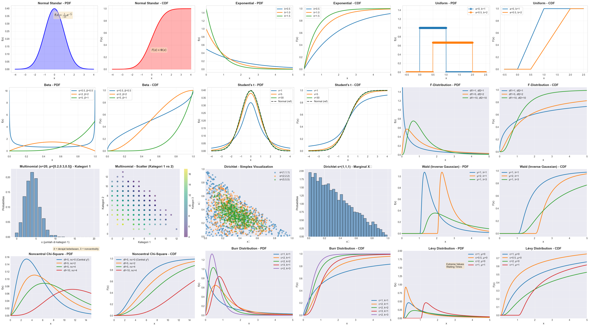
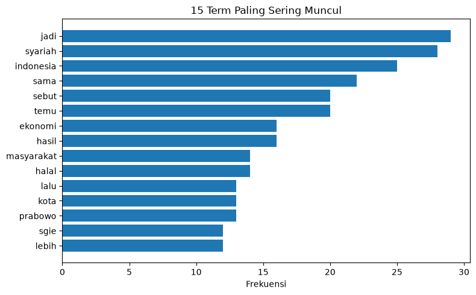
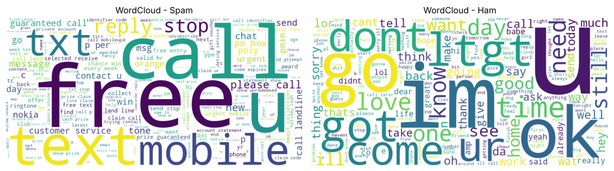
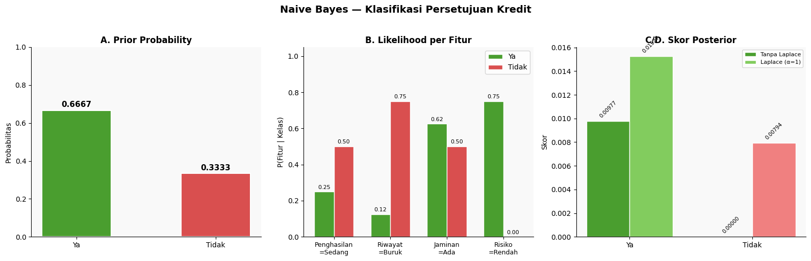
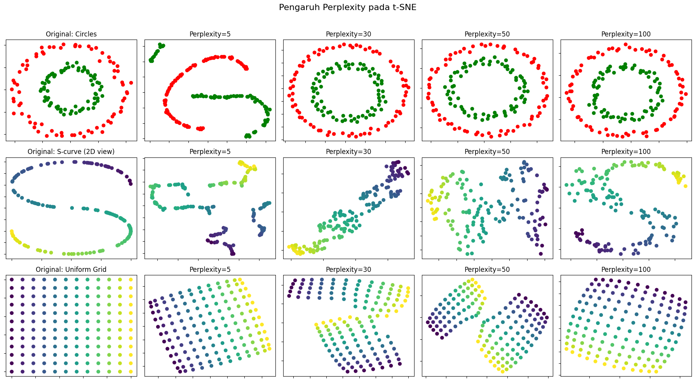
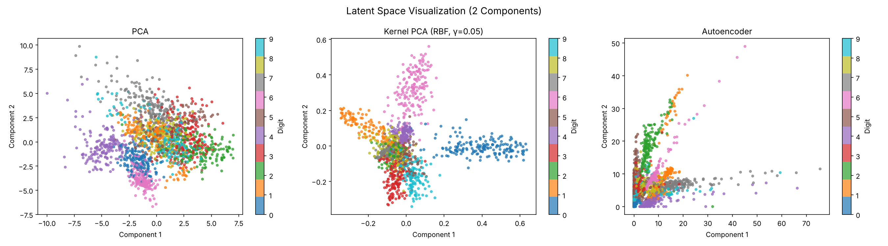
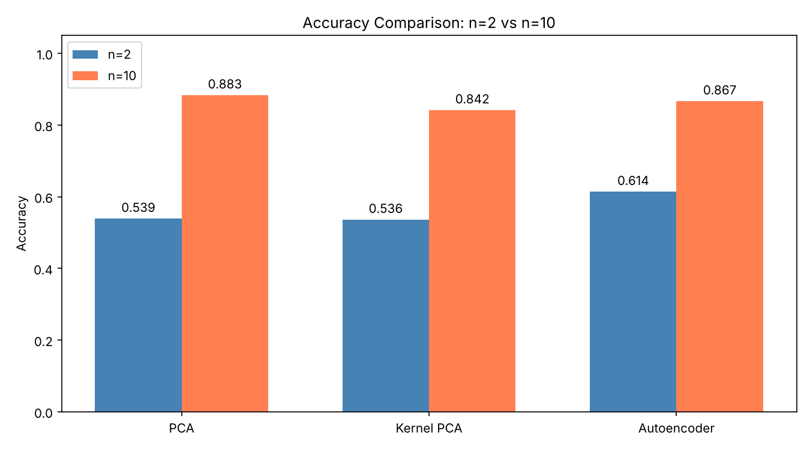
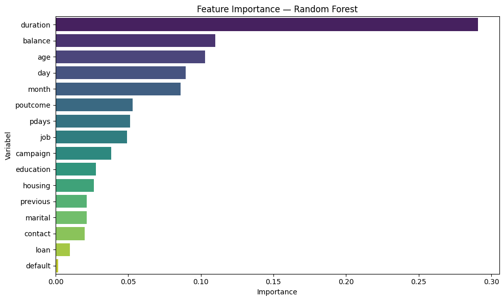
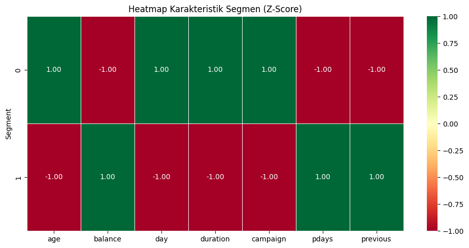

<div align="center">

# Data & Text Mining Coursework

**Kumpulan tugas mata kuliah Data Mining dan Text Mining: web scraping dan NLP bahasa Indonesia, klasifikasi probabilistik, visualisasi distribusi statistik, reduksi dimensi, hingga segmentasi nasabah.**




</div>

---

##  Daftar Isi

| # | Topik | Notebook | Teknik Utama |
|:---:|---|---|---|
| 1 | [**Text Mining**](#1--text-mining) | [Web scraping detik.com + TF-IDF](01-text-mining/01_web_scraping_tfidf_detik.ipynb) | `requests`, BeautifulSoup, Sastrawi, inverted index, TF-IDF manual |
| | | [Rule-based English stemmer](01-text-mining/02_custom_english_stemmer.ipynb) | *Suffix stripping* dari nol |
| | | [Analisis SMS spam vs ham](01-text-mining/03_sms_spam_tfidf.ipynb) | NLTK, lemmatization, TF-IDF, word cloud |
| 2 | [**Naive Bayes Manual**](#2--naive-bayes-manual) | [Klasifikasi persetujuan kredit](02-naive-bayes-manual/naive_bayes_kredit.ipynb) | Prior, likelihood, posterior, Laplace smoothing |
| 3 | [**Distribusi Probabilitas**](#3--visualisasi-90-distribusi-probabilitas) | [90 distribusi: PDF & CDF](03-probability-distributions/distribusi_probabilitas.ipynb) | SciPy, implementasi rumus manual |
| 4 | [**Reduksi Dimensi**](#4--reduksi-dimensi) | [PCA pada Iris](04-dimensionality-reduction/01_pca_iris.ipynb) | PCA |
| | | [Pengaruh perplexity t-SNE](04-dimensionality-reduction/02_tsne_perplexity.ipynb) | t-SNE |
| | | [PCA vs Kernel PCA vs Autoencoder](04-dimensionality-reduction/03_pca_kpca_autoencoder.ipynb) | Kernel PCA, Keras autoencoder |
| 5 | [**Segmentasi Nasabah Bank**](#5--segmentasi-nasabah-bank) | [Analisis deposito berjangka](05-bank-customer-segmentation/bank_customer_segmentation.ipynb) | Random Forest, uji statistik, K-Means |

---

## 1.  Text Mining

### 1.1 Web Scraping detik.com + Preprocessing + TF-IDF
 [`01_web_scraping_tfidf_detik.ipynb`](01-text-mining/01_web_scraping_tfidf_detik.ipynb)

Pipeline lengkap dari mengambil berita secara langsung (*live*) hingga representasi vektor:

```
Scraping indeks berita → ambil isi artikel → case folding → cleaning → tokenizing
→ stopword removal (Sastrawi + stopword khas portal berita) → stemming (Sastrawi, dengan cache)
→ frekuensi term → inverted index → term-document matrix → TF-IDF
```

- **8 artikel** berhasil diambil, menghasilkan **2.094 token** dengan **794 term unik**.
- **Inverted index** dibangun manual; ini adalah struktur inti mesin pencari.
- **TF-IDF dihitung manual** dengan rumus `TF × log₁₀(N/DF)`, lalu dibandingkan dengan `TfidfVectorizer`. Notebook juga menjelaskan perbedaannya (*smooth IDF* dan normalisasi L2).
- Hasil preprocessing dan matriks TF-IDF tersimpan di [`outputs/`](01-text-mining/outputs/).



### 1.2 Rule-Based English Stemmer
 [`02_custom_english_stemmer.ipynb`](01-text-mining/02_custom_english_stemmer.ipynb)

*Stemmer* bahasa Inggris yang dibangun **tanpa library NLP**:
- Daftar sufiks berurutan dari yang terpanjang (`-ational`, `-ization`, … `-ing`, `-ed`, `-s`)
- Panjang minimum stem dan **daftar pengecualian** (`king`, `news`, `series`, …)
- **Perbaikan ejaan** setelah pemotongan: `studies → study`, `running → run`
- Diuji otomatis terhadap daftar kata dan hasil yang diharapkan

### 1.3 Analisis SMS Spam vs Ham
 [`03_sms_spam_tfidf.ipynb`](01-text-mining/03_sms_spam_tfidf.ipynb) · Dataset: [SMS Spam Collection (UCI)](https://archive.ics.uci.edu/dataset/228/sms+spam+collection)

Membandingkan kata kunci khas SMS spam dan SMS normal (ham) berdasarkan **rata-rata bobot TF-IDF**.

| Top 5 Spam | Mean TF-IDF | Top 5 Ham | Mean TF-IDF |
|---|:---:|---|:---:|
| call | 0,054 | ok | 0,020 |
| free | 0,038 | im | 0,019 |
| mobile | 0,029 | call | 0,016 |
| claim | 0,028 | get | 0,014 |
| ur | 0,027 | ill | 0,014 |

SMS spam didominasi kata ajakan dan iming-iming (*call, free, claim, prize, urgent, cash*), sedangkan SMS ham berisi bahasa percakapan sehari-hari.



---

## 2.  Naive Bayes Manual
 [`naive_bayes_kredit.ipynb`](02-naive-bayes-manual/naive_bayes_kredit.ipynb)

Memprediksi apakah pengajuan kredit **disetujui**, dengan menghitung Naive Bayes **langkah demi langkah** (rumus ditulis dalam LaTeX):

| Langkah | Rumus |
|---|---|
| A. Prior | P(C) = jumlah kelas C / total data |
| B. Likelihood | P(Xᵢ = x \| C) |
| C. Posterior | P(C \| X) ∝ P(C) · ∏ P(Xᵢ \| C) |
| D. Keputusan | argmax P(C \| X) |

**Data uji:** Penghasilan = Sedang, Riwayat Kredit = Buruk, Jaminan = Ada, Risiko = Rendah

| Metode | Skor "Ya" | Skor "Tidak" | Prediksi |
|---|:---:|:---:|:---:|
| Naive Bayes | 0,009766 | 0,000000 | **Disetujui** |
| + Laplace smoothing (α = 1) | 0,015273 | 0,007937 | **Disetujui** |

Notebook ini juga memperlihatkan **zero-frequency problem**: skor "Tidak" bernilai 0 karena tidak ada data `Risiko = Rendah` di kelas "Tidak". *Laplace smoothing* mengatasinya.



---

## 3.  Visualisasi 90 Distribusi Probabilitas
 [`distribusi_probabilitas.ipynb`](03-probability-distributions/distribusi_probabilitas.ipynb)

Setiap distribusi divisualisasikan dalam panel **PDF/PMF** dan **CDF** dengan beberapa kombinasi parameter, sehingga pengaruh tiap parameter terhadap bentuk distribusi langsung terlihat. Distribusi yang tidak tersedia di `scipy.stats` diimplementasikan langsung dari rumus matematikanya.

| Kelompok | Contoh |
|---|---|
| Kontinu umum | Normal, Exponential, Uniform, Gamma, Beta, Lognormal, Weibull, Student's t, F, Chi-Square |
| Ekor berat & nilai ekstrem | Cauchy, Pareto, Lomax, Gumbel, Fréchet, GEV, Lévy, Burr, Dagum |
| Diskrit | Binomial, Poisson, Geometric, Negative Binomial, Hypergeometric, Zipf, Yule, Benford |
| Multivariat & campuran | Multinomial, Dirichlet, Mixture Normal, Compound Poisson |
| Khusus | Johnson SU/SB, Wrapped Normal, Wigner semicircle, Tukey Lambda, Generalized Hyperbolic |

---

## 4.  Reduksi Dimensi

### 4.1 PCA pada Iris
 [`01_pca_iris.ipynb`](04-dimensionality-reduction/01_pca_iris.ipynb): 4 fitur direduksi menjadi 2 komponen yang menjelaskan **95,8% variansi** (72,96% + 22,85%).

### 4.2 Pengaruh Perplexity pada t-SNE
 [`02_tsne_perplexity.ipynb`](04-dimensionality-reduction/02_tsne_perplexity.ipynb): perplexity 5–100 pada dataset *circles*, *S-curve*, dan *uniform grid*.



### 4.3 PCA vs Kernel PCA vs Autoencoder
 [`03_pca_kpca_autoencoder.ipynb`](04-dimensionality-reduction/03_pca_kpca_autoencoder.ipynb)

Dataset **Digits** (64 fitur) direduksi dengan tiga metode, lalu kualitas reduksinya diukur dengan akurasi **Logistic Regression**:

| Dimensi | PCA | Kernel PCA (RBF, γ = 0,05) | Autoencoder |
|:---:|:---:|:---:|:---:|
| n = 2 | 53,9% | 53,6% | **61,4%** |
| n = 10 | **88,3%** | 84,2% | 86,7% |

- Pada **2 dimensi**, autoencoder (non-linear) paling baik menjaga informasi kelas.
- Pada **10 dimensi**, PCA linear sudah cukup dan justru paling unggul.
- *Tuning* γ Kernel PCA: γ terbaik **0,01** (86,7%). Nilai γ yang terlalu besar (≥ 0,5) merusak performa secara drastis (< 16%).

<table>
  <tr>
    <td width="60%"></td>
    <td width="40%"></td>
  </tr>
</table>

---

## 5.  Segmentasi Nasabah Bank
 [`bank_customer_segmentation.ipynb`](05-bank-customer-segmentation/bank_customer_segmentation.ipynb) · 📄 [Soal](05-bank-customer-segmentation/soal.pdf) · Dataset: [Bank Marketing (UCI)](https://archive.ics.uci.edu/dataset/222/bank+marketing), 45.211 nasabah

Menjawab 5 pertanyaan bisnis tentang kampanye pemasaran deposito berjangka:

| Soal | Metode | Temuan |
|:---:|---|---|
| 1. Seleksi variabel | Random Forest feature importance | 7 variabel terpilih; **`duration`** (lama panggilan) paling dominan (0,29) |
| 2. Profil nasabah | Statistik deskriptif | Mayoritas menikah (60%), pendidikan menengah; hanya **11,7%** yang berdeposito |
| 3. Deposito vs tidak | Uji Mann-Whitney U & Chi-Square | Nasabah berdeposito memiliki **durasi panggilan ±2,4× lebih lama** dan saldo lebih tinggi; usia tidak berbeda signifikan (p = 0,063) |
| 4. Segmentasi | K-Means + Elbow & Silhouette | **k = 2** segmen optimal |
| 5. Penyebab tidak berdeposito | Profil per segmen | Segmen 0 (deposit rate 10,2%) lebih sering dihubungi tetapi belum pernah dikontak sebelumnya; segmen 1 (19,3%) memiliki riwayat kampanye sebelumnya |

<table>
  <tr>
    <td width="50%"></td>
    <td width="50%"></td>
  </tr>
</table>

---

##  Cara Menjalankan

```bash
git clone https://github.com/r4dtwhle/data-text-mining-coursework.git
cd data-text-mining-coursework

python -m venv venv
venv\Scripts\activate          # Windows
# source venv/bin/activate     # macOS / Linux
pip install -r requirements.txt

jupyter notebook
```

> Jalankan setiap notebook **dari dalam foldernya masing-masing**, karena path data dan gambar bersifat relatif terhadap folder notebook.
> Notebook web scraping mengambil berita yang sedang tayang, sehingga hasilnya akan berbeda dari output yang tersimpan.

---

##  Struktur Folder

```
data-text-mining-coursework/
├── 01-text-mining/
│   ├── 01_web_scraping_tfidf_detik.ipynb
│   ├── 02_custom_english_stemmer.ipynb
│   ├── 03_sms_spam_tfidf.ipynb
│   ├── data/            # SMS Spam Collection
│   ├── outputs/         # hasil preprocessing & matriks TF-IDF berita
│   └── images/
├── 02-naive-bayes-manual/
├── 03-probability-distributions/
├── 04-dimensionality-reduction/
├── 05-bank-customer-segmentation/
│   ├── soal.pdf
│   ├── data/            # Bank Marketing (UCI)
│   └── images/
├── requirements.txt
├── LICENSE
└── README.md
```

---

<div align="center">
<sub>Dibuat oleh <a href="https://github.com/r4dtwhle">r4dtwhle</a> · Tugas mata kuliah Data Mining & Text Mining · Lisensi MIT (kode)</sub>
</div>
